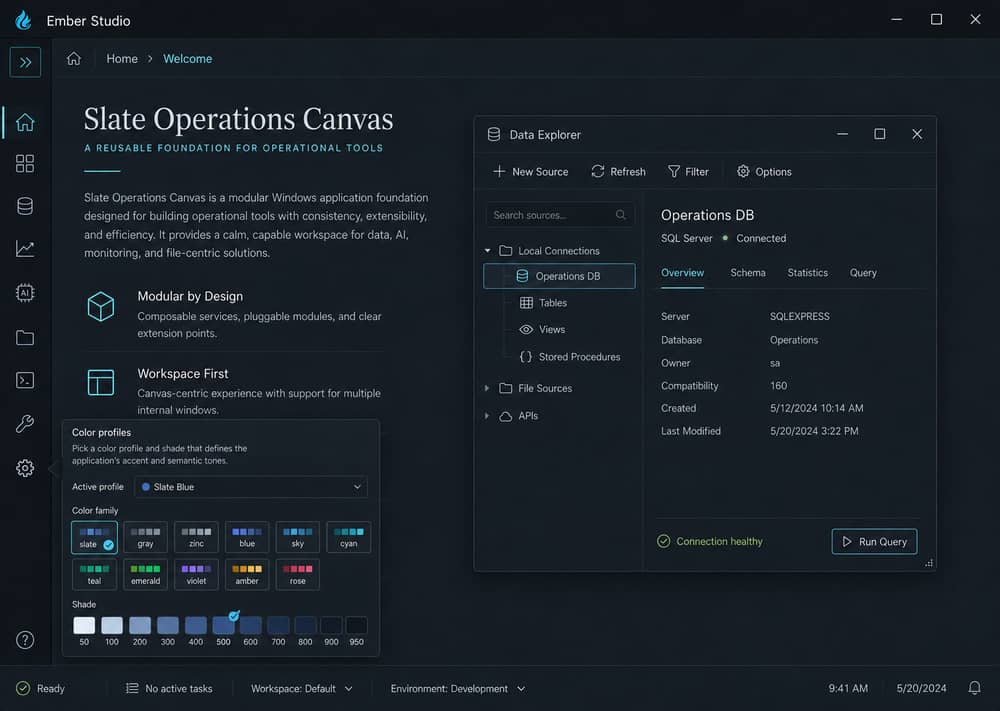
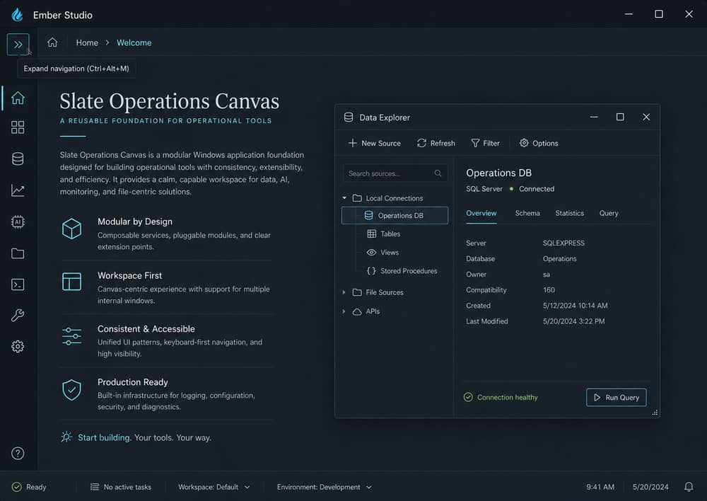

# Ember Studio Foundation

Reusable Windows desktop application foundation built with React, TypeScript, Vite, and Tauri. Ember Studio is intentionally business-domain neutral so it can become the starting point for data, media, AI, monitoring, file-viewing, vehicle-data, or other specialized desktop applications.

The project provides a smoky-black, blue-accented desktop shell for future applications, including:

- Borderless custom title bar with native window controls
- Collapsible navigation and project-owned design tokens
- Internal window manager with move, resize, minimize, maximize, and z-order behavior
- Optional external Tauri feature windows
- Generic file, settings, notification, dialog, tooltip, and feedback service boundaries
- Placeholder Data Explorer and foundation welcome experience
- Typed service contracts for future Java, Python, Rust, C#, or local HTTP/WebSocket services

The application uses an opaque smoky-black main surface with restrained blue accents. Secondary menus, popovers, and information panels may use smoky glass treatment without making the primary workspace transparent.

## Development

Requires Node.js 22.12 or newer and npm (CI uses Node 22).

Install dependencies and start the frontend preview:

```bash
npm ci
npm run dev
```

Run the frontend checks:

```bash
npm test
npm run build
```

Open http://localhost:8080 in your browser. Without cloud environment settings, the app uses its existing guest/demo mode. Guest project edits are session-only and are lost on reload; export work before closing. Browser mode does not provide native desktop window controls.

Optional cloud mode requires both `VITE_SUPABASE_URL` and `VITE_SUPABASE_PUBLISHABLE_KEY` in `.env.local` before starting/building. Use a publishable key, never a secret/service-role key. A standalone installer built without these values starts in guest mode.

### Run the native Windows app without installing it

Install [Tauri v2 Windows prerequisites](https://v2.tauri.app/start/prerequisites/#windows): Rust stable with the MSVC toolchain, Microsoft C++ Build Tools (Desktop development with C++ and Windows SDK), and WebView2 Runtime. From the repository root:

```powershell
npm ci
npm run tauri:dev
```

This starts Vite automatically and opens the native app. Do not start a separate `npm run dev` at the same time: both use port 8080.

### Build Windows installers

On Windows with the same prerequisites:

```powershell
npm ci
npm test
npm run tauri:build
```

Outputs are `src-tauri/target/release/bundle/nsis/*.exe` and `src-tauri/target/release/bundle/msi/*.msi`. The compiled app can also run directly at `src-tauri/target/release/ember-studio.exe` without installing (WebView2 must be available).

Alternatively, run **Actions → Windows installer → Run workflow** on your branch, or use the installer artifact attached to a successful pull-request build. Download and extract **layers-windows-installer** from that run. Builds are unsigned; Windows may show an unknown-publisher prompt. Version tags (`v*`) publish the built installers to a GitHub release.

## Edit your own app

1. Run your app's dev server (for example `npm run dev` on `http://localhost:5173`).
2. Connect it to the bridge. For Vite apps, install `packages/radium-bridge` and add `radiumBridge()` to `vite.config` (see [packages/radium-bridge/README.md](packages/radium-bridge/README.md)); every element then reports its file and line. Any other web app can add one `<script>` line instead.
3. In Layers, choose **Connect app** on the canvas and enter the address. The frame shows **Connected · file:line** when source ids are available.
4. Use **Comment** (C) to click any element and say what should change. Layers saves the comment with the element's file and line, its current look, and two screenshots: the whole screen with the element outlined, and the element itself. Use **Grab** (V) to try style changes live; the mouse wheel still scrolls your app.
5. On the **Production** page, choose **Save for agent**. Pick your app's folder once; Layers writes `.radium/production/plan.md`, `plan.json` and `shots/`. Then **Copy agent prompt** and paste it into Claude Code (or another agent) in your app's folder.

Try it with the bundled sample app: `npm run sample-app`, then connect `http://localhost:5173`.

In the desktop app, the pin button in the title bar keeps Layers floating above other windows.

## Foundation conventions

- Keep reusable infrastructure in the shared folders listed below.
- Put application-specific behavior under `src/features/<feature-name>`.
- Keep file processing, persistence, and long-running work behind typed services instead of React components.
- Use the project-owned design tokens and shared feedback components when adding UI.
- Treat Tauri commands as a native boundary with JSON-compatible contracts.

## Windows acceptance

The frontend test suite, TypeScript project check, and Vite production build run in this repository. Before shipping a Windows application based on this template, also validate the native Tauri build and runtime behavior on Windows, including borderless dragging, resize edges and corners, minimize/maximize/restore, multi-monitor placement, per-monitor DPI, external feature windows, and saved window state.

## Architecture

- `src/app` — application composition
- `src/shell` — title bar, navigation, status bar, and branding
- `src/design-system` — editable tokens, color profiles, and theme state
- `src/windows` — reusable internal and native window infrastructure
- `src/external-windows` — feature window lifecycle and routing
- `src/file-system`, `src/settings`, `src/notifications`, `src/dialogs`, `src/tooltips`, `src/feedback` — shared service boundaries
- `src/features` — future application-specific features
- `src-tauri` — native Windows/Tauri commands and persistence boundary
- `docs/architecture/backend-boundary.md` — backend integration guidance

## Backend integration

Future local services can replace adapters without changing feature components. A Java, Python, Rust, or C# worker can communicate through a Tauri command, local HTTP, WebSocket, JSON message channel, or another documented transport. Long-running work should report progress and cancellation asynchronously rather than blocking the React UI thread.

## GitHub automation

The repository includes three lightweight GitHub automations:

- **CI** runs the frontend tests, TypeScript check, Vite build, and a Windows native `cargo check`.
- **CodeQL** scans the JavaScript/TypeScript source for security problems and coding errors.
- **Dependabot** opens weekly dependency update pull requests for npm and Cargo packages.

These checks are designed to run before changes are merged into `main`.

The main application surface is opaque. Smoky glass treatment is reserved for secondary panels, popovers, and overlays.

## Visual previews

Click either preview to open the full-size image on GitHub.

[](docs/screenshots/ember-studio-color-profiles.jpg)

[](docs/screenshots/ember-studio-collapsed-navigation.jpg)

## License

Released under the MIT License. See [LICENSE](./LICENSE).
